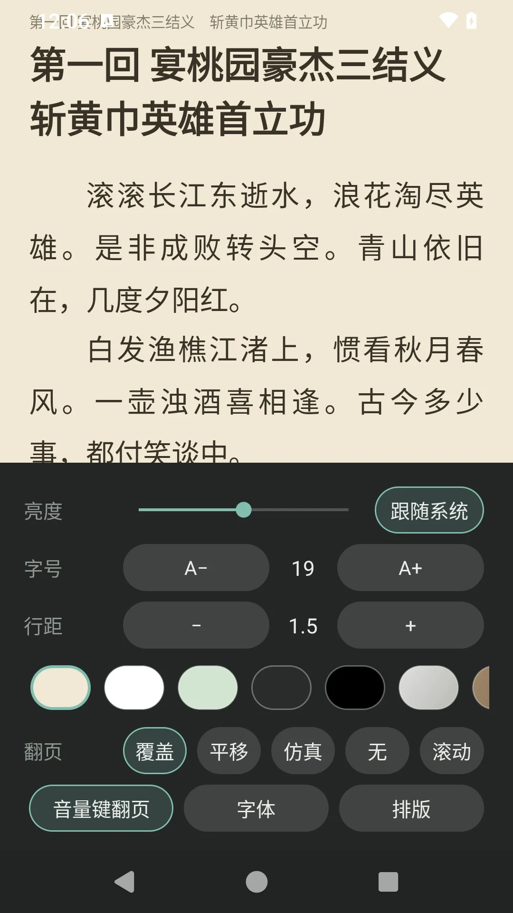
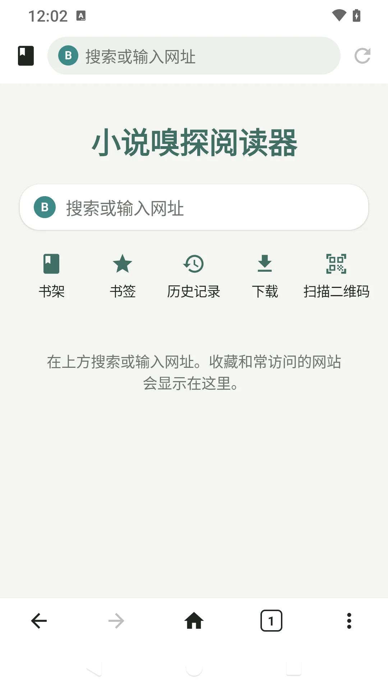
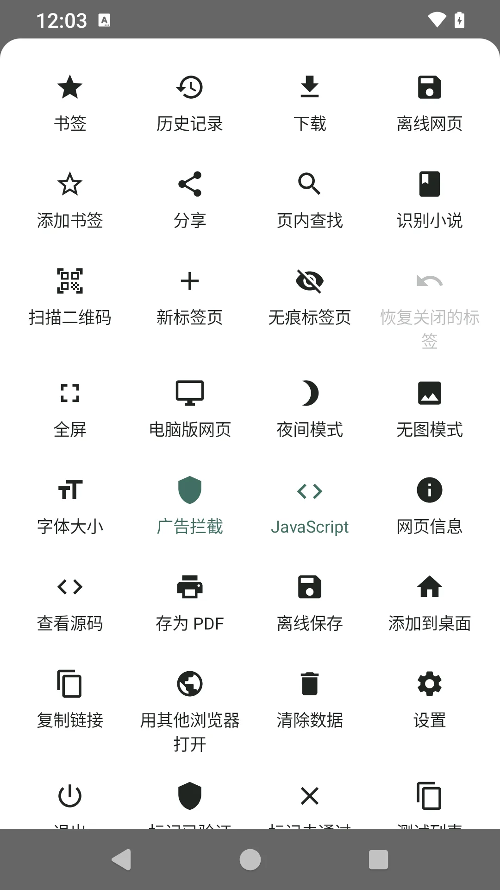

# OnlineNovelReader · 小说嗅探阅读器

| | | |
|:---:|:---:|:---:|
|  |  |  |
|  |  |  |

An Android browser that recognises novel pages on any site, strips the ads and clutter, and turns
them into a native reading experience with a bookshelf and whole-book caching.

- Package `com.rc.novelreader`, min SDK 23, target SDK 34, plain Java + framework views.
- **Updates** - on start the app asks GitHub (at most once a day, can be switched off) whether a newer release
  exists and offers it: update (downloads and installs the release's package), cancel, or skip this version.
- **Tests** - JVM unit tests for the engine, on-device tests against a novel site served inside the test
  (`sh tools/devtest.sh`), and a smoke run under hard conditions with leak detection (`python tools/smoke.py`).
  Debug builds carry [LeakCanary](https://square.github.io/leakcanary/); release builds do not.
- Dependencies: [jsoup](https://jsoup.org) (HTML parsing for the sniffing engine) and
  [ZXing core](https://github.com/zxing/zxing) (reading QR codes; Apache 2.0).
- UI languages: English and Simplified Chinese.

## Build, install, test

```
gradlew.bat :app:assembleDebug            # app/build/outputs/apk/debug/NovelSniffer-debug.apk
gradlew.bat :app:testDebugUnitTest        # sniffing-engine tests (run on the JVM, no device needed)
adb install -r app/build/outputs/apk/debug/NovelSniffer-debug.apk
```

## How it works

### Module 1 - browser and ad blocking (`browser/`)

`BrowserActivity` is a tabbed WebView browser; each `Tab` owns a lazily created WebView, so restored and
background tabs cost nothing until shown (at most six stay live, older ones reload on return).

- **Tabs** - background and incognito tabs, links that ask for a new window open as child tabs
  (Back returns to the parent), reopen closed tab, crash recovery of a single tab. The tab button opens a
  **grid of previews**, two to a row, each with title, close button and the top of its page. A swipe along the
  address bar (or on the tab button, where a short swipe crosses many tabs) turns the page into a card in a
  **row of previews** that follows the finger, like the recent-apps view of Android; the row glides to the
  nearest card when the finger lifts and only then is that tab switched to. The previews are drawn from what
  is on screen and kept per tab, so they cost no request.
- **Tabs after a restart** - the tabs of last time come back in the tab views with their previews, but none is
  loaded until you pick it; the browser starts on the start page (a setting opens the last page instead).
- **Address bar** - URL or search, suggestions from bookmarks, history and the search engine, paste-and-go,
  security icon with certificate details, bookmark star, per-page blocked counter. While you type (and on the
  start page) the icon in front is the **search engine's**: tap it for a drop-down that switches engines.
  On every page there is a **reading-mode button**: green when a novel was recognised (tap to read), else it
  has the page looked at now.
- **Start page** - search box, bookmark tiles, most visited sites, shortcuts to the bookshelf and library.
- **QR codes** - "Scan QR code" (menu, start page, or a long-press action) reads a code with the camera or from
  a gallery picture; a long press on a picture in a page reads the code in it. The content is shown first,
  opening or searching it is your tap.
- **Site icons** - the icon of every visited site is kept (one per host, no extra requests) and shown in
  bookmarks, history, start-page tiles, address suggestions and the tab list.
- **Library** (`LibraryActivity`) - bookmarks (edit, import/export as a standard bookmarks HTML file), history,
  downloads (system download manager: progress, open, delete) and saved offline pages, all searchable.
- **Long-press actions** - holding any of the five bottom buttons or the reload button runs an action of your
  choice (Settings > "Long-press actions of the buttons"): tabs, navigation, lists, page switches, and the
  novel actions (bookshelf, reading mode, detect novel, continue the book read last). Defaults: Back closes
  the tab, Forward opens the history, Home opens the bookshelf, Tabs opens a new tab.
- **Page tools** - find in page, share, long-press menus for links and images, desktop site, night mode
  (colour inversion), no-images mode, text zoom, per-site JavaScript switch, view source, save as PDF, save
  offline (MHT), add to home screen, full-screen browsing, full-screen video, file upload.
- **Site permissions** - location, camera and microphone are asked per request; HTTP authentication, form
  resubmission and "open another app" prompts; pages can never launch other apps without a tap and a confirmation.
- **Settings** - search engine (incl. custom URL), user agent, cookies, clear data (also on exit), default browser,
  user scripts (`UserScripts`: Greasemonkey-style header, `@match` patterns, no `GM_*` API).

`AdBlocker` works in three layers:

1. **Network** - requests to hosts in `assets/adhosts.txt` (suffix match), to hosts of an optional subscribed
   list (hosts file, domain list or the domain rules of an Adblock list; Settings > Block list subscription)
   and ad-looking third-party URLs are answered with an empty response.
2. **Strict mode on novel sites** - once the sniffer has recognised a host as a novel site,
   third-party scripts and frames are blocked there too, script-initiated cross-site redirects are
   stopped, and pop-ups to other sites are dropped. A CDN/captcha allow-list keeps sites working.
   On a first visit a script redirect that fires before the sniffer has finished is held back and only
   carried out if the page turns out not to be a novel page.
3. **Cosmetic** - `assets/cosmetic.js` hides ad containers, floating boxes that show third-party
   media, and transparent full-page click-hijack layers; it re-runs when the DOM changes.

The feature set follows a survey of small open-source WebView browsers (Ninja, FOSS Browser and its forks,
Tuff Browser, Lightning, Yuzu). No code was taken from them: most are GPL or custom-licensed.

### Module 2 - dual-engine sniffer (`sniff/`, pure Java, unit-tested)

`Sniffer.analyze(url, html)` returns a `PageResult`: page type (chapter / book page / none), scores,
book metadata, chapter list, cleaned chapter text, next/previous/contents links.

- **Engine 1, rules (`RuleEngine`, `SiteRule`)** - CSS-selector rules, tried in the order
  user rules > learned rules > built-in template rules (`assets/rules.json`). A rule applies by host
  regex and/or by a structural *signature* selector, so one rule covers every clone of a template.
  Every field is optional.
- **Engine 2, heuristics (`HeuristicEngine`)** - three independent detectors:
  - *main text block*: text density, link density, paragraph structure, id/class hints, and the share
    of the page's text it holds (search results and portals spread text thin);
  - *navigation*: next / previous / contents links by label (text, `aria-label`, `rel`), inline script
    variables, breadcrumbs (HTML and schema.org JSON-LD), with paginated-chapter detection;
  - *chapter list*: the DOM container whose links best look like an ordered run of chapters
    (title patterns incl. Chinese numerals, URL shape, monotonic ids), de-duplicating "latest chapters"
    blocks, flipping newest-first lists, following list pagination and "all chapters" links.
  Rule selectors override the corresponding detector; the heuristics fill in everything a rule omits.
- **Learning** - when pure heuristics succeed with high confidence, the selectors they chose are stored
  as a learned rule for that host, which then also handles pages too short to score on their own.
- `ContentCleaner` removes watermarks, "remember this site" lines, nav crumbs and inline ads, and
  re-joins hard-wrapped lines of old fixed-width pages.

The browser feeds the *rendered* DOM to the sniffer; background loading uses plain HTTP first
(`net/Http`: shared user agent and cookies, GBK/GB18030 detection) and falls back to an off-screen
WebView (`net/WebFetcher`) for pages built by JavaScript or hidden behind interstitials.

### Module 3 - reader (`reader/`)

`PageView` typesets chapters itself and renders them as pages (cover / slide / instant turn) or as a
continuous vertical scroll, keeping the previous and next chapter loaded so turning never waits at a
chapter boundary. `ReaderActivity` adds the menus: contents drawer (cached chapters highlighted,
reversible), chapter slider, font size, line spacing, themes with a night toggle, brightness, volume-key
paging, reload chapter, open the original page.
While a chapter loads the page shows its heading, a spinner, the step the fetch is at (contacting the site,
background browser, retry after an ad, looking for the next chapter) and the seconds waited; turning on
waits until it is there instead of skipping it. A chapter that fails says why in plain words with the
technical detail underneath, and has Retry and Open in browser on the page itself, so they turn and scroll
with it and are also there when it is the next chapter showing under the one being read. As long as you
keep reading, a failed chapter is asked for again by itself once a minute until it loads (the page counts
down; Settings > "Retry a failed chapter every minute" turns it off); a site's
error page (HTTP error status, or a "not found / try again / loading" page in the reader's template) is
never stored as a chapter.
A book without a contents page ends in a page of its own: turning past the last chapter shows the search for
the next one there, then the chapter, or "this is the last chapter" / why the search failed with the same two
buttons. The last chapter of such a book is shown as soon as its text is there, while the app is still finding
out where the book goes on. Entering reading mode on a chapter that is open in the browser uses that page's
text (and a contents page's list) instead of asking the site for it again. "More" has a connection test that
asks Bing and Google for one page each, to tell a dead network from a dead site.
When a site puts a "prove that you are human" check in the way, the app does not keep asking: the chapter's
page says so and its button opens the site's check in a window over the book. Pass it there and the window
closes by itself, the chapter taken from the page you just saw. Caching a book stops at once on such a check
or on "too many requests". The fetchers also remember per site what they learned (pages that need the
rendering engine, sites whose last chapter simply has no next link), so the same lesson is not paid for with
a request every time.
Reading position (chapter + text offset) is restored exactly, also after changing the font.

Behind "More" in the reading menu:

- **Tap zones**: the screen is a 3x3 grid, each cell opens the menu, turns back, turns forward or does nothing.
  Default: left column back, right column forward, centre menu; one tap sets "everything but the centre
  turns forward".
- **Fonts**: system, serif, monospace, or any imported TTF/OTF file.
- **Themes**: five flat colours, one theme for every picture in `app/src/main/assets/paper` (ten now: five
  seamless paper textures from [ambientCG](https://ambientcg.com), CC0, and five sheets of old paper from
  papertexture.io; see the `LICENSE.txt` there), and your own: background colour, text colour, one of those
  papers or a picture. Adding a background to the app is dropping a `.jpg` or `.webp` into that folder: a
  picture that repeats seamlessly is tiled and takes the theme's colour, any other is shown as one page.
- **Keyboard**: arrows, PageUp/PageDown, Space and Enter turn pages (in scroll mode the up/down arrows move a
  few lines); `[` `]` or Ctrl+arrows change chapter; Home, M/F10 (menu), T (contents), N (night), F (search),
  B (bookmark), S (read aloud), A (auto scroll; Space pauses it), +/- (text size), Esc. The list is under Controls.
- **Settings** opens the app settings without leaving the book.
- **Layout**: left/right/top/bottom margins, line, paragraph and letter spacing, first-line indent, justified lines (on by default), bold,
  header and footer on or off.
- **Screen**: stays on always, for N minutes after the last touch (default 10), or as the system decides;
  orientation lock; warm eye-care tint.
- **Break reminder**: after N minutes of reading the reader locks for M minutes.
- **Read aloud** with the system text-to-speech engine: the spoken passage is marked and the page follows,
  speed, pitch, sleep timer, continues into the next chapter and with the screen off.
- **Filler filter**: author notes, vote begging, thanks to donors, group plugs and lines repeated in every
  chapter are left out at the start and end of chapters (`sniff/FillerFilter`, can be switched off).
- **Selection**: long-press selects the word under the finger (keep the finger down and move to take more).
  The two handles hang under the line, outside the selected text, and are held, not aimed at: the selection
  follows the handle's corner while a magnifier shows the spot (Android 9+); pull a handle past the other
  end and they swap; hold it past the last line and the page turns (scrolled text moves on) with the
  selection growing along. "Expand" grows it to the sentence, then to the paragraph. Then copy, highlight,
  note, look up, search the whole book for it, share, read aloud from there, replace or hide. Replacements (plain or regular expression, for one
  book or all) are listed and edited on their own screen, "Text replacements"; they never change the cached text.
- Bookmarks, search in the cached chapters. Going to a hit folds the search into a small bar in the page's
  top right corner (previous hit, position, next hit, end); its middle opens the list again as it was left.
- **Page curl**: a fifth page-turn mode with a folding page, its shadow and the print showing through.
- **Two pages side by side** when the screen is wide (landscape tablets); can be switched off.
- **Highlights and notes**: five colours, a note per highlight, a list per book, export as text. Tap a
  highlight to edit it.
- **Look up / translate** a selection: web search, any dictionary app that accepts text, or the AI assistant.
  Words looked up go into a **word list** with their sentence and are reviewed at growing intervals.
- **Reading statistics**: minutes per day (two weeks), streak, total, time in this book, reading speed and
  the time the rest of the chapter will take. Also on the shelf menu.
- **Gestures**: every tap zone, swipe up, swipe down and double tap can open the menu, turn a page, change
  chapter, open the contents, switch night mode, add a bookmark, start reading aloud, start auto page, search
  or leave. A drag along the left edge can set the brightness.
- **Automatic scrolling** in every page mode (More > Auto scroll, the A key, or a tap zone / gesture). Scroll
  mode moves the text up steadily. The page modes send a line down the page that uncovers the next page behind
  it (as Legado and Moon+ Reader do), left column first when two are shown; this can be switched to a plain
  turn when the time is up. While it runs, a tap on the menu zone opens a strip with speed, pause, stop and
  menu; the volume keys change the speed, Space pauses, a finger on the page holds it. It runs on into the
  next chapter and stops at the end of the book.
- **Speed reading**: the chapter flashed piece by piece at a set pace.
- **Reading ruler**: everything but a movable band of lines is dimmed.
- **Simplified / traditional Chinese** conversion (character table from OpenCC, Apache-2.0).
- **Night theme by the clock**, shake to start or pause reading aloud.
- **Online voice**: reading aloud through a speech service of your choice instead of the system engine (an
  address with `{{speakText}}`; the simple "httpTTS" addresses made for the Legado reader work).
- **AI assistant** (off until you enter a service and key; Claude Messages API or an OpenAI-compatible
  endpoint): chapter summary, "the story so far", questions answered only from what you have read, explaining
  and translating a selection.

On the shelf menu: **import a book** from a TXT (UTF-8, UTF-16, GBK) or EPUB file, and **backup and restore**
(one zip with the shelf, progress, settings, notes, statistics and word list, optionally the cached text; to a
file or to a WebDAV folder when you press the button).

Books whose site has no contents page are read in *linked mode*: chapters are chained through their
"next chapter" links as you read or cache.

### Module 4 - bookshelf (`shelf/`, `data/`)

`ShelfActivity` is the home screen: cover grid (as many columns as the width holds, three on a phone), search box into the browser, sort orders, pinning,
update checks (manual; automatic every 2 hours only if switched on) with "N new" badges, per-book cache /
clear cache / TXT export / remove. `DownloadService` caches chapters in a foreground service
(3 workers, stops itself if the site starts refusing requests). Chapter text is stored as files,
everything else in SQLite (`data/Db`).
With Settings > Reading > "Continue reading on start" (off by default) starting the app opens the book read
last instead of the shelf; Back from it leads to the shelf as usual. Leaving a book that is not on the shelf asks whether to add it; "Do not ask again" keeps the answer given, and the setting next to it changes it back.

## Custom site rules

Settings > Site rules takes a JSON array. Selector syntax is jsoup CSS, optionally followed by
`@attr` to read an attribute:

```json
[{
  "name": "example",
  "host": "(^|\\.)example\\.com$",
  "signature": "div#chapter-body",
  "content": "div#chapter-body",
  "chapterTitle": "h1.chapter-title",
  "next": "a.next-chapter", "prev": "a.prev-chapter", "tocLink": "a.back-to-book",
  "chapterList": "ul.chapters li a",
  "bookTitle": "h1.book-name", "author": "meta[name=author]@content",
  "cover": "img.cover@src", "intro": "div.synopsis",
  "purify": ["Visit example\\.com for more"]
}]
```

## Testing aids

- `tools/mock_site/gen.py <dir>` generates a deliberately messy fake novel site (GBK template site with
  ad overlays and paginated chapters, paginated chapter list, English unnumbered list, JavaScript-rendered
  book, book without a contents page, a portal home page that must not be detected). Serve it with
  `python -m http.server 8765 --directory <dir>` and open it from the device.
- Debug builds add "Mark verified", "Mark failed" and "Test lists" at the end of the browser menu: a local record
  of which sites were tested by hand, with a badge in the top right corner of pages on a marked site.
- In debuggable builds the browser's "Sniff this page" button (magnifier) saves the page DOM to
  `files/sniff/`. Pull those files into a folder and run the unit tests with `SNIFF_DIR=<folder>`:
  `RealPagesTest` writes `report.txt` there with what the engine made of each page.

## Hijacked navigation

Some sites answer "next chapter" with an advertiser at random: a redirect to another domain, or the ad in the
link itself. Such answers are never taken as "no more chapters". The reader asks the same address again (up to
3 times), and at the end of a book that has no chapter list it asks the last page again for its next link. In
the browser, on recognised novel sites, a tapped link that lands on another site is re-requested.

A "next chapter" button without an address (a script decides where it goes) is pressed in the background page
and the address it leads to is taken. Readers without any "next" link, which load the next chapter when you
pull up at the bottom of the page, are followed too: the background page is scrolled to its end with a simulated finger drag and the address it moves
to becomes the next chapter.

No site is special-cased: built-in rules match page templates by structure only, never by host name.

## Request budget

Novel sites often count requests per IP, so by default the app only requests what you ask for: the page you
browse, the chapter you turn to, a contents page you refresh. Everything else is a switch under
Settings > "Optional requests to novel sites", off by default: automatic shelf update checks, the check for
new chapters at the last page, preloading neighbouring chapters, fetching the contents page when a book is
opened from a chapter page, and cover downloads. The one switch there that is on by default repeats a chapter
that failed to load once a minute while you are reading. Search suggestions and restoring tabs on start are off by
default too.

## Not included

Switching a book between source sites, an LLM-based sniffing engine (the second engine is algorithmic), a
different voice per character, paragraph comments, PDF/MOBI import and automatic sync (the WebDAV backup is by
hand). In the browser: incognito tabs keep out of history and the tab session but
share cookies with normal tabs (a WebView limitation), `blob:` downloads, bar codes other than the square ones, page translation,
bookmark folders and sync are not implemented.
